# Intelligent Document Assistant

<!-- Stack teknologi. Versinya disamakan dengan pyproject.toml dan
     package.json, jadi badge ini ikut berubah saat dependency diperbarui. -->
[](https://nextjs.org)
[](https://react.dev)
[](https://www.typescriptlang.org)
[](https://tailwindcss.com)
[](https://fastapi.tiangolo.com)
[](https://www.python.org)
[](https://www.trychroma.com)
[](https://www.sqlite.org)
[](https://groq.com)
[](https://ollama.com)

<!-- Status kualitas. Angkanya berasal dari perintah di bagian verifikasi,
     bukan klaim. Badge CI diambil langsung dari hasil GitHub Actions, jadi
     kalau ada yang rusak, badge-nya merah. -->
[](https://github.com/aldyardnsyh/IntelligenceDocumentSystem/actions/workflows/ci.yml)
[](#verifikasi-dan-pengujian)
[](#verifikasi-dan-pengujian)
[](#verifikasi-dan-pengujian)
[](LICENSE.md)

Asisten tanya jawab untuk dokumen pribadi Anda. Unggah berkas PDF, TXT, atau
Markdown, lalu ajukan pertanyaan dalam Bahasa Indonesia dan dapatkan jawaban
yang disertai sumber yang bisa diklik.

Yang membedakan aplikasi ini dari sekadar chatbot: sistem **tidak mengarang**.
Kalau jawabannya tidak ada di dokumen Anda, sistem mengatakannya terus terang.
Kalau Anda mengizinkan mode pengetahuan umum, jawabannya diberi label tegas
supaya tidak tertukar dengan jawaban yang bersumber dokumen.

## Cara kerjanya

```
Unggah -> parse -> [PDF scan? -> render halaman -> OCR: PP-OCR lokal, halaman
        sulit dieskalasi ke model vision] -> potong jadi chunk per Pasal
        -> embedding (e5-base) -> pencarian hybrid (BM25+Sastrawi & vektor)
        -> rerank cross-encoder multilingual
                                            |
                                    bukti cukup?
                                      |     |      |
                                     ya   lemah   kosong
                                      |     |      |
                          jawaban +   jawaban  "tidak ditemukan" +
                          sitasi      berlabel  saran kata kunci
                                      "bukti terbatas"
```

Dua jalur ingestion yang menentukan mutu retrieval, khususnya untuk dokumen
legal hasil pindai (misal Lembaran Negara dari peraturan.bpk.go.id):

1. **OCR hybrid PP-OCR + vision.** Text-layer PDF dinilai dulu (mode
   `auto`). PDF pindai yang text-layer-nya kosong — atau rusak seperti PDF
   BPK yang urutan bacanya kacau dan kata-katanya terpecah (`Undang-Undan g`)
   — dirender per halaman menjadi gambar dan diekstraksi **PP-OCR lokal**
   (model PP-OCR via RapidOCR/ONNX, tanpa biaya). Urutan baca dua kolom
   dipulihkan dari bounding box, dan hanya halaman dengan confidence rendah
   yang dieskalasi ke model vision Groq. Sinyal deteksi kerusakan text-layer
   diukur, bukan ditebak (rasio token satu huruf, halaman kosong, baris
   noise). Lihat `backend/app/services/ingestion/text_quality.py`,
   `ocr_engine.py`, dan `ocr.py`.
2. **Chunking struktur hukum.** Dokumen yang terdeteksi sebagai peraturan
   (heading BAB/Bagian/Pasal) dipecah **per Pasal**, bukan per paragraf.
   Baris pertama setiap chunk memuat konteksnya:
   `BAB II – PENGELOLAAN PENGADUAN · Bagian Kedua – Sarana Pengaduan · Pasal 5`
   — retrieval jadi tahu Pasal mana yang sedang dicari, dan halaman detail
   menampilkan badge "Pasal N" di tiap chunk. Dokumen non-legal tetap memakai
   chunking paragraf generik. Lihat `backend/app/services/ingestion/legal.py`.

3. **Retrieval berlapis.** BM25 dengan stemmer Sastrawi (`pengaduan`,
   `mengadu`, `diadukan` bertemu di bentuk dasar yang sama), embedding
   `multilingual-e5-base`, dan reranker cross-encoder multilingual
   (`bge-reranker-v2-m3`) yang menilai ulang kandidat. Jawaban tidak lagi
   ditolak keras di batas ambang: kalau bukti lemah tapi ada, jawaban tetap
   diberikan dengan label "bukti terbatas"; kalau benar-benar kosong,
   penolakan disertai saran kata kunci.

Tiga aturan yang menjaga sistem ini bisa dipercaya:

1. **Jawaban tanpa konteks tidak pernah diberi sitasi.** Kalau tidak ada
   potongan dokumen yang cukup mirip, sistem tidak berpura-pura menemukannya.
2. **Setiap dokumen bisa punya percakapan privatnya sendiri.** Sesi ber-scope
   hanya mencari di dokumen itu. Sesi lintas dokumen tetap tersedia.
3. **Semua angka berasal dari server.** Jumlah chunk, ambang kemiripan,
   latensi, dan token semuanya hasil pengukuran, bukan nilai contoh.

## Model dan provider LLM

Jawaban dirangkai oleh satu provider utama dengan rantai fallback. Konfigurasi
yang dipakai untuk demo dan produksi memakai **Groq** sebagai provider utama:

```ini
LLM_PROVIDER=groq
LLM_MODEL=qwen/qwen3.8-27b
GROQ_API_KEY=<kunci Anda>
```

Groq, Ollama, SGLang, dan endpoint OpenAI-compatible memakai protokol yang sama
(`/chat/completions`). Karena itu provider bisa ditukar lewat konfigurasi saja:
tidak ada kode khusus per vendor di jalur jawaban.

Kalau Anda punya endpoint OpenAI-compatible sendiri (router, agregator, atau
proxy internal), arahkan provider ke sana dan isi `LLM_MODEL` dengan nama model
yang ada di katalog penyedia tersebut:

```ini
LLM_PROVIDER=openai_compatible
LLM_MODEL=<nama model di katalog penyedia Anda>
OPENAI_COMPATIBLE_BASE_URL=https://endpoint-anda/v1
OPENAI_COMPATIBLE_API_KEY=<kunci Anda>

LLM_FALLBACK_CHAIN=groq
GROQ_API_KEY=<kunci Anda>
GROQ_MODEL=qwen/qwen3.8-27b
```

`GROQ_MODEL` perlu diisi terpisah karena katalog model tiap penyedia berbeda.
`LLM_MODEL` menunjuk model provider utama, dan nama itu belum tentu ada di
katalog Groq; tanpa `GROQ_MODEL`, fallback akan meminta model yang tidak ada
dan rantai gagal tepat saat dibutuhkan. Nilai `qwen/qwen3.8-27b` adalah model
Groq yang diuji stabil sebagai cadangan ketika provider utama memakai katalog
model yang berbeda.

`LLM_FALLBACK_CHAIN` adalah daftar nama provider yang dipisah koma. Provider
aktif selalu dicoba lebih dulu, lalu setiap nama di daftar dicoba berurutan
ketika provider sebelumnya gagal karena kuota atau gangguan jaringan. Nama
yang tidak dikenal menggagalkan start dengan pesan yang menyebut pilihan yang
tersedia; salah ketik tidak dilewati diam-diam, karena provider yang dimaksud
tidak akan pernah dipanggil dan tidak ada gejala yang menunjuk ke sana.

Kunci API tidak pernah ditulis di repo. Isi hanya di `backend/.env`, yang sudah
di-gitignore, atau lewat environment server.

## Prompt-guard

Aturan di prompt sistem saja tidak cukup untuk konteks dokumen yang tidak
tepercaya. Setiap potongan yang akan masuk prompt dinilai lebih dulu oleh
classifier `meta-llama/llama-prompt-guard-2-86m` (86 juta parameter). Skor
risiko 0 sampai 1 di atas ambang membuat potongan itu dibuang dari konteks dan
tidak ikut disitasi, sehingga instruksi terselubung di dalam dokumen tidak
pernah sampai ke model generasi.

| Variabel | Bawaan | Arti |
|---|---|---|
| `PROMPT_GUARD_ENABLED` | `1` | Menyalakan penyaringan |
| `PROMPT_GUARD_MODEL` | `meta-llama/llama-prompt-guard-2-86m` | Nama classifier |
| `PROMPT_GUARD_THRESHOLD` | `0.5` | Skor di atas nilai ini memblokir chunk |

Ambang 0,5 dipilih karena pemisahannya lebar: percobaan injection yang nyata
memberi skor 0,9 ke atas, sedangkan teks legal normal berada di 0,0 sampai 0,1.

Guard bersifat **fail-open**: kalau classifier gagal, timeout, atau providernya
tidak siap, konten tetap lolos tanpa skor dan jawaban tetap berjalan. Ini
disengaja. Classifier adalah lapisan tambahan, bukan satu-satunya kontrol;
menjatuhkan seluruh jawaban karena satu pemeriksaan tambahan gagal akan membuat
gangguan kecil terasa seperti aplikasi mati.

Guard **dipin ke Groq**, bukan mengikuti provider generation, karena model
classifier hanya ada di katalog Groq. Konsekuensinya `GROQ_API_KEY` tetap perlu
diisi walaupun generation berjalan di provider lain. Tanpa kunci itu, guard
dimatikan dan alasannya dicatat di log server, bukan dibiarkan tampak aktif
padahal tidak memeriksa apa pun.

## Mode akses terbuka (demo publik)

Untuk presentasi, dua sakelar harus dinyalakan bersamaan:

```ini
# backend/.env
AUTH_OPEN_MODE=1

# frontend/.env.local
NEXT_PUBLIC_OPEN_MODE=1
```

Backend menerbitkan sesi otomatis untuk pengunjung yang belum punya cookie,
lalu melewati verifikasi passcode pada request pertama. Frontend melewati gate
halaman dan mengalihkan `/login` ke `/chat`, sehingga tautan dari landing page
langsung mendarat di aplikasi tanpa satu klik tambahan.

Ini **hanya untuk demo publik, bukan produksi**. Selama mode ini menyala,
siapa pun yang menemukan URL dapat membaca dan mengunggah dokumen di server
itu; tidak ada akun per pengunjung dan tidak ada isolasi data antar pengunjung.
Untuk mengembalikan gerbang passcode, set `AUTH_OPEN_MODE=0` dan
`NEXT_PUBLIC_OPEN_MODE=0` (atau hapus barisnya), lalu deploy ulang frontend
karena nilai `NEXT_PUBLIC_*` dibekukan saat build. Logika login tidak dihapus,
hanya dilewati.

## Mulai dari mana?

Pilih sesuai yang ingin Anda lakukan. Dua panduan di bawah ditulis langkah
demi langkah, dengan perintah yang bisa langsung disalin, dan penjelasan apa
yang seharusnya muncul di setiap langkah.

| Tujuan | Panduan | Waktu |
|---|---|---|
| **Melihat hasilnya di komputer sendiri** | [PANDUAN-LOKAL.md](PANDUAN-LOKAL.md) | 5 menit untuk tampilan, 30 menit untuk versi penuh |
| **Memasangnya di server supaya bisa dibuka dari mana saja** | [PANDUAN-DEPLOY-VPS.md](PANDUAN-DEPLOY-VPS.md) | 30 sampai 60 menit |

Keduanya memuat bagian masalah yang sering terjadi, beserta gejalanya, jadi
kalau ada langkah yang tidak sesuai Anda tidak perlu menebak.

Sisanya di README ini menjelaskan cara kerja, keputusan teknis, dan hasil
pengujian. Bacalah kalau Anda ingin memahami alasannya, bukan hanya
menjalankannya.

## Daftar isi

- [Model dan provider LLM](#model-dan-provider-llm)
- [Prompt-guard](#prompt-guard)
- [Mode akses terbuka (demo publik)](#mode-akses-terbuka-demo-publik)
- [Coba tanpa backend (2 menit)](#coba-tanpa-backend-2-menit)
- [Jalankan lengkap (backend + frontend)](#jalankan-lengkap-backend--frontend)
- [Dokumen contoh untuk pengujian](#dokumen-contoh-untuk-pengujian)
- [Tampilan dan halaman](#tampilan-dan-halaman)
- [Cara memakai fitur utamanya](#cara-memakai-fitur-utamanya)
- [Verifikasi dan pengujian](#verifikasi-dan-pengujian)
- [Deployment ke server](#deployment-ke-server)
- [Panduan terpisah: lokal dan deploy](PANDUAN-LOKAL.md)
- [Struktur proyek](#struktur-proyek)
- [Kualitas dan pengujian](#kualitas-dan-pengujian)
- [Keamanan](#keamanan)
- [Keputusan teknis penting](#keputusan-teknis-penting)
- [Lisensi](#lisensi)

## Coba tanpa backend (2 menit)

Cara tercepat melihat seluruh halaman. Data berasal dari fixture di browser,
jadi tidak perlu Python maupun API key.

```powershell
cd frontend
npm install
npm run dev
```

Buka <http://localhost:3000>. Banner "Mode demo" akan muncul, artinya data
bukan dari backend. Passcode demo ditampilkan di layar login.

## Jalankan lengkap (backend + frontend)

Butuh Python 3.11 atau lebih baru dan Node.js 20 atau lebih baru.

### Langkah 1: siapkan backend

```powershell
cd backend
python -m venv .venv
.\.venv\Scripts\Activate.ps1
pip install -e ".[dev]"
pip install sentence-transformers
Copy-Item .env.example .env
python -m scripts.make_passcode
```

Perintah terakhir menanyakan passcode pilihan Anda dan menyimpan hash-nya ke
`.env`. Passcode aslinya tidak pernah tersimpan di berkas mana pun.

### Langkah 2: jalankan backend

```powershell
python -m uvicorn app.main:app --reload --port 8000
```

Tunggu sampai muncul `Application startup complete`. Pada start pertama, model
embedding (sekitar 470 MB) diunduh dan disimpan di cache. Ini hanya terjadi
sekali.

Cek dari terminal lain:

```powershell
Invoke-RestMethod http://127.0.0.1:8000/api/v1/health
```

Yang diharapkan: `status: ok`, `llm: ok`, dan `fallback.mode: full`. Kalau
`LLM_PROVIDER` masih `mock` bawaan `.env.example`, statusnya sengaja
`degraded`: tidak ada model bahasa yang benar-benar dipanggil, jadi health
tidak boleh terlihat sehat. Isi provider seperti pada bagian
[Model dan provider LLM](#model-dan-provider-llm) sebelum menganggap
pemasangan selesai.

### Langkah 3: siapkan frontend

```powershell
cd frontend
npm install
Copy-Item .env.example .env.local
```

Pastikan `.env.local` berisi dua baris ini:

```ini
NEXT_PUBLIC_USE_BACKEND=1
BACKEND_ORIGIN=http://127.0.0.1:8000
```

Kalau ingin passcode dev terlihat di layar login, tambahkan juga:

```ini
NEXT_PUBLIC_DEV_PASSCODE_HINT=passcode-anda
```

### Langkah 4: jalankan frontend

```powershell
npm run dev
```

Buka <http://localhost:3000>, masuk dengan passcode yang Anda buat di Langkah 1,
lalu unggah dokumen pertama Anda.

### Langkah 5: isi database contoh (opsional)

Untuk mencoba cepat tanpa menyiapkan dokumen sendiri:

```powershell
cd backend
python -m scripts.seed_demo
```

Perintah itu membuat satu dokumen SOP contoh, lalu Anda bisa bertanya:
*"berapa hari untuk penyelesaian permintaan?"*

## Dokumen contoh untuk pengujian

Folder `backend/samples/` berisi tiga berkas dengan format berbeda:

| Berkas | Format | Yang diuji |
|---|---|---|
| `kebijakan-cuti.txt` | teks | pemotongan dan pencarian pada teks polos |
| `panduan-tiket-layanan.md` | Markdown | heading menjadi chunk tersendiri |
| `laporan-infrastruktur.pdf` | PDF | ekstraksi teks per halaman |

## Cara memakai fitur utamanya

### Bertanya dan membaca sitasi

1. Buka `/chat`, tulis pertanyaan, tekan Enter.
2. Jawaban muncul mengalir, diikuti kartu sitasi.
3. Klik salah satu kartu untuk membuka dokumen sumbernya di chunk yang tepat.

### Mengatur seberapa ketat pencarian

Buka `/settings`:

- **Top K**: berapa banyak potongan dokumen yang diambil. Semakin besar,
  semakin banyak konteks, tapi jawaban bisa kurang fokus.
- **Ambang kemiripan**: batas minimal skor agar sebuah potongan dipakai.
  Rentang 0,70 sampai 0,92 diukur untuk model embedding yang dipakai. Nilai
  lebih tinggi membuat sistem lebih sering menjawab "tidak ditemukan".

### Percakapan privat per dokumen

Ada dua cara memulai:

- Buka `/documents`, klik **Tanya dokumen ini** pada kartu dokumen.
- Buka `/chat`, pilih dokumen dari daftar di sidebar.

Header akan menampilkan badge nama dokumen. Selama badge itu ada, pencarian
hanya berjalan di dokumen tersebut. Klik **Percakapan baru** untuk kembali ke
mode lintas dokumen.

### Mode jawab tanpa dokumen

Saat jawabannya tidak ada di dokumen Anda, ada dua perilaku yang bisa dipilih
lewat sakelar di bawah kolom pertanyaan:

- **Sakelar menyala** (bawaan): sistem menjawab dari pengetahuan umum model,
  dengan label tegas "Bukan dari dokumen Anda" dan tanpa sitasi.
- **Sakelar mati**: sistem menjawab "tidak ditemukan".

Yang tidak pernah terjadi di kedua mode: jawaban mengarang yang diberi sitasi
seolah-olah bersumber dari dokumen Anda.

### Melihat isi dokumen untuk memeriksa jawaban

Buka `/documents`, pilih salah satu dokumen. Ada dua tab:

- **Pratinjau isi**: berkas aslinya. Untuk PDF, ditampilkan langsung di
  halaman. Untuk teks, isinya ditampilkan berurutan.
- **Chunk hasil ingestion**: bagaimana dokumen dipotong, beserta posisi tiap
  potongan.

Cara memeriksa: buka PDF-nya, cari bagian yang disebut jawaban chat, lalu
bandingkan dengan chunk di tab sebelah. Kalau ada bagian yang terlihat di PDF
tapi tidak muncul di chunk, ekstraksi teksnya yang gagal membaca bagian itu.

### Menjalankan evaluasi kualitas

Buka `/analytics`, pilih dokumen yang ingin diuji, lalu klik **Jalankan
evaluasi**. Sistem menjalankan daftar pertanyaan contoh terhadap dokumen yang
Anda pilih dan melaporkan:

- **Precision**: seberapa tepat sumber yang diambil.
- **Hit rate**: berapa banyak pertanyaan yang menemukan sumbernya.
- **Penolakan benar**: berapa pertanyaan "tidak ada jawaban" yang benar
  ditolak.

Evaluasi ini tidak memerlukan API key tambahan. Untuk skor RAGAS lengkap
(termasuk faithfulness yang dinilai oleh model kedua), lihat bagian
[Evaluasi dengan RAGAS](#evaluasi-dengan-ragas).

### Menguji dokumen Anda sendiri dengan dataset berlabel

Halaman `/analytics` memakai pertanyaan contoh bawaan. Untuk menguji dokumen
Anda sendiri dari terminal, jalankan harness evaluasi end-to-end:

```powershell
cd backend
python -m scripts.eval_perpres --pdf "dokumen-anda.pdf" --json-out hasil-eval.json
```

`--pdf` wajib dan harus menunjuk berkas Anda sendiri; tidak ada path lokal yang
di-hardcode di repo, sehingga clone baru bisa langsung dipakai untuk dokumen
apa pun. Dataset bawaan `evaluation/dataset-perpres.json` hanyalah **contoh**
22 soal untuk Perpres 76 Tahun 2013 — 18 soal yang harus dijawab, 3 yang harus
ditolak, dan 1 sapaan yang harus dijawab sebagai smalltalk — bukan keterikatan
sistem pada korpus tersebut. Sistem berlaku untuk dokumen apa pun; buat dataset
sendiri berisi pertanyaan dan `ground_truth` untuk dokumen Anda, lalu jalankan
perintah yang sama.

Harness menjalankan pipeline yang sama dengan pengguna: PDF diunggah, di-OCR
bila perlu, dipotong per Pasal, diindeks, lalu setiap pertanyaan dijawab lewat
`RagService`. Karena itu satu run bisa memakan beberapa menit, tergantung
jumlah halaman dan provider yang aktif. Opsi lain: `--dataset` untuk berkas
soal lain, `--limit` untuk mencoba beberapa soal lebih dulu, `--db` untuk
lokasi basis data evaluasi, dan `--json-out` untuk menyimpan hasil lengkap.

Penilaiannya **kasar dan sengaja diberi label**. Untuk soal `answer`, skor
dihitung dari persentase kata kunci `ground_truth` yang muncul di jawaban;
`refuse` lolos bila sistem menjawab "tidak ditemukan"; `smalltalk` lolos bila
jawaban terisi dan bukan penolakan. Angka ini berguna untuk mendeteksi regresi
antar run pada korpus yang sama, tetapi **bukan pengganti penilaian manusia**:
model boleh memakai sinonim sehingga coverage rendah belum tentu salah, dan
jawaban yang keliru bisa menyalin kata kunci sehingga coverage tinggi belum
tentu benar. Baca jawabannya, jangan hanya melihat persentasenya.

### Mengganti model embedding dan membangun ulang indeks

Model bawaan adalah `intfloat/multilingual-e5-base` dengan
`EMBEDDING_DIMENSION=768`. Vektor yang tersimpan dibuat oleh model tertentu,
jadi mengganti `EMBEDDING_MODEL` atau `EMBEDDING_DIMENSION` membuat indeks
Chroma lama tidak cocok dengan vektor baru. Gejalanya menipu: dokumen tetap
berstatus siap, pertanyaan wajar, tetapi retrieval mengembalikan hasil acak
atau tidak menemukan apa pun tanpa error yang menunjuk penyebabnya.

Setelah mengubah kedua nilai itu di `.env`:

```powershell
cd backend
python -m scripts.reindex
```

Skrip ini membaca ulang isi chunk dari database metadata, menghitung vektor
baru dengan model yang aktif, lalu mengganti seluruh isi koleksi vektor.
Dokumen tidak perlu diunggah ulang hanya untuk memperbaiki vektor. Akan tetapi,
`reindex` tidak mengubah cara dokumen dipotong: chunk lama yang dibuat sebelum
chunking legal aktif tidak punya metadata Pasal. Untuk mendapatkan header
`BAB`/`Pasal` pada chunk, hapus dokumen lama lalu unggah ulang setelah reindex
selesai.

## Tampilan dan halaman

Tangkapan layar di bawah diambil dari aplikasi yang berjalan sungguhan dengan
tiga dokumen contoh dan beberapa percakapan. Tidak ada data tiruan: setiap
angka dan kutipan berasal dari backend yang sama dengan yang dipakai di
produksi.

### Halaman masuk

<p align="center">
  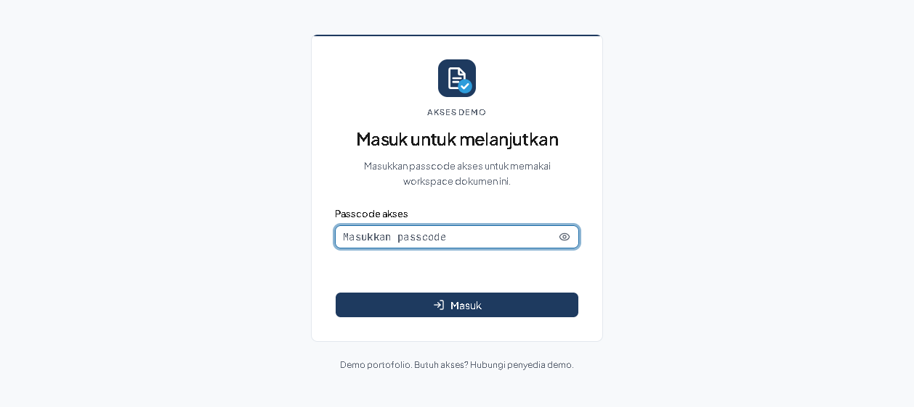
</p>

Satu pintu masuk untuk seluruh aplikasi. Passcode bukan formalitas: seluruh
dokumen pengguna berada di baliknya, jadi panjang minimumnya 12 karakter dan
percobaan yang gagal dibatasi per alamat IP. Di mode pengembangan, passcode
contoh ditampilkan sebagai petunjuk supaya tidak ada tebakan.

### Beranda

<p align="center">
  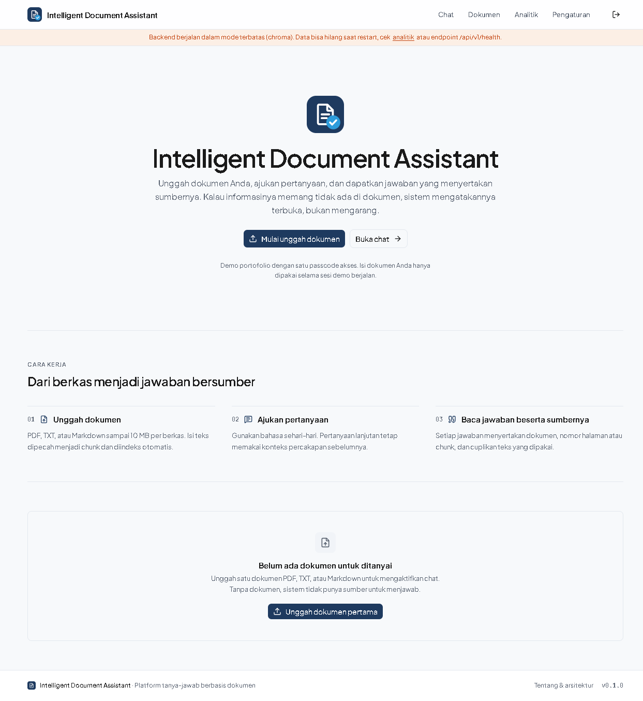
</p>

Ringkasan keadaan sistem dan jalan masuk ke setiap fitur. Angka yang tampil
dibaca dari backend, bukan konstanta di halaman, sehingga beranda tidak pernah
menampilkan keadaan yang berbeda dari isi sebenarnya.

### Chat

<p align="center">
  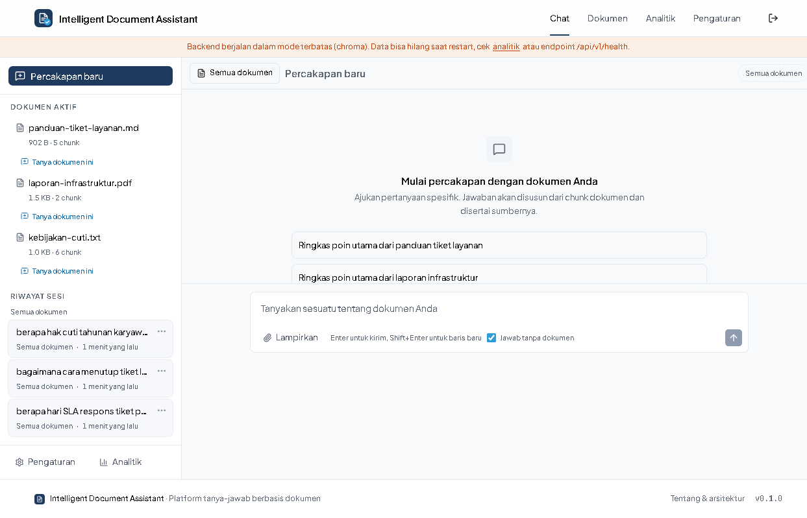
</p>

Halaman utama. Di kiri ada daftar dokumen aktif dan riwayat percakapan; di
kanan ada kotak tanya. Tombol "Tanya dokumen ini" mengunci percakapan ke satu
dokumen, sehingga pertanyaan lanjutan tidak pernah mencari ke dokumen lain.
Pemilih di atas kotak tanya membatasi pencarian ke beberapa dokumen sekaligus,
dan tanpa pilihan berarti semua dokumen.

<p align="center">
  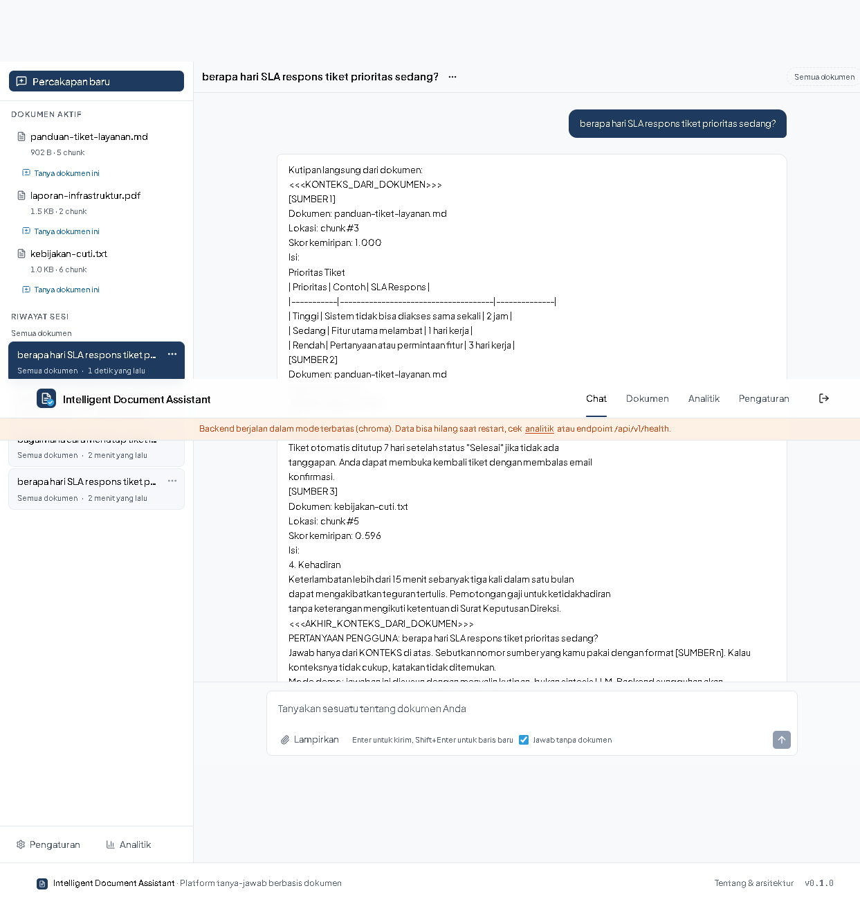
</p>

Setiap jawaban membawa sumbernya. Panel "3 sumber ditemukan" bisa dibuka untuk
melihat kutipan, nomor chunk, dan skor kemiripan. Kalau tidak ada bagian
dokumen yang cukup mirip, sistem tidak mengarang: ia mengatakan tidak
menemukan, atau menjawab dari pengetahuan umum dengan label tegas.

<p align="center">
  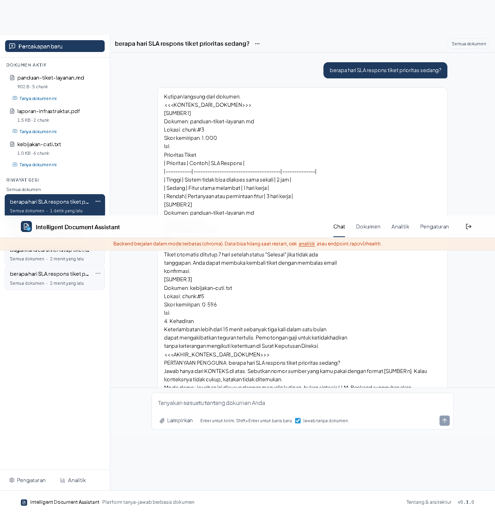
</p>

Sumber bisa diklik dan membawa ke chunk yang dimaksud di halaman dokumen. Itu
sebabnya tautannya memuat nomor chunk, bukan hanya id dokumen: jawaban
seharusnya bisa diverifikasi sampai ke bagian teks yang dipakai.

### Dokumen

<p align="center">
  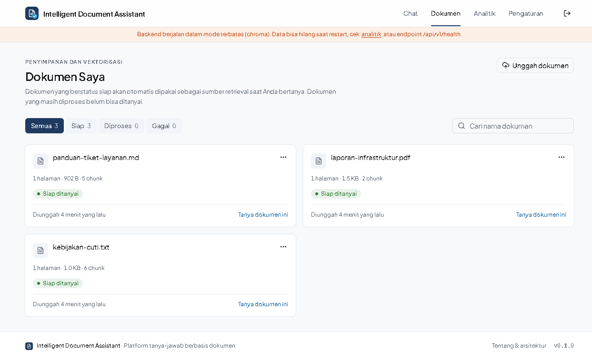
</p>

Unggah PDF, TXT, atau Markdown, lalu pantau statusnya. Dokumen hanya bisa
ditanyai setelah statusnya "Siap ditanyai", dan status itu diperbarui berkala
selama masih ada yang diproses. Saringan dan pencarian bekerja pada metadata,
jadi tidak perlu memuat ulang halaman.

<p align="center">
  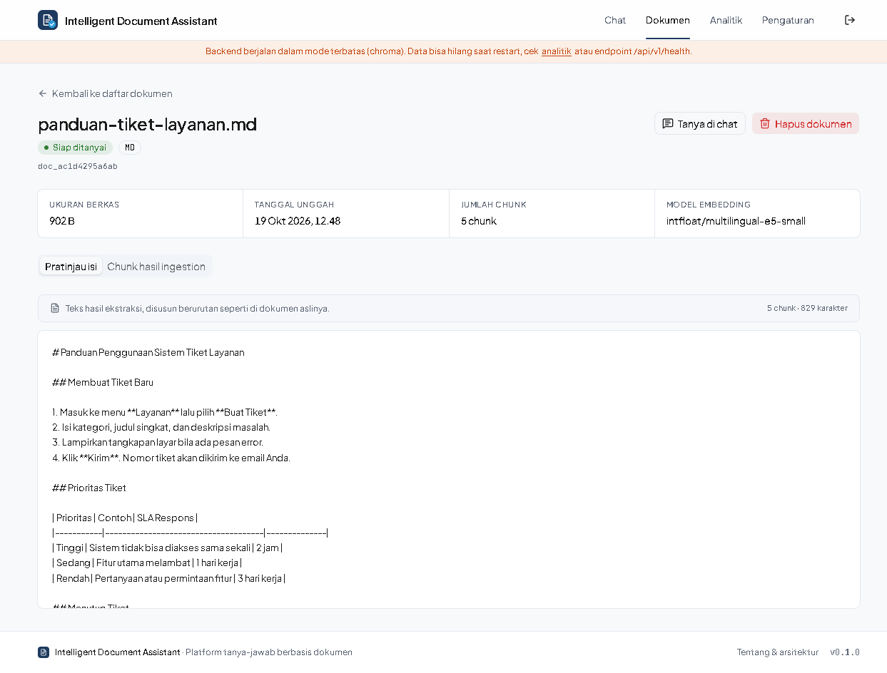
</p>

Halaman detail menampilkan metadata dan pratinjau isi teks. Berkas asli bisa
dibuka berdampingan untuk dokumen PDF, sehingga tata letak dan tabel bisa
diperiksa tanpa harus mengunduhnya.

<p align="center">
  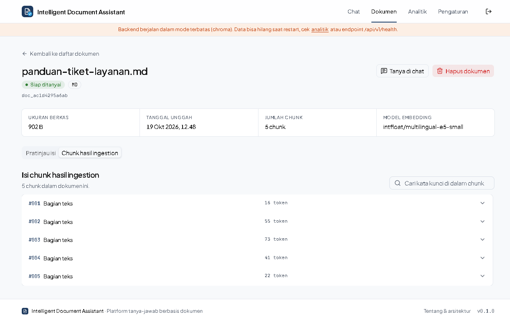
</p>

Tab chunk menunjukkan bagaimana dokumen dipotong sebelum diindeks. Ini bagian
yang paling sering menjelaskan mengapa sebuah pertanyaan tidak menemukan
sumber: potongannya bisa dilihat langsung, bukan ditebak.

### Analitik

<p align="center">
  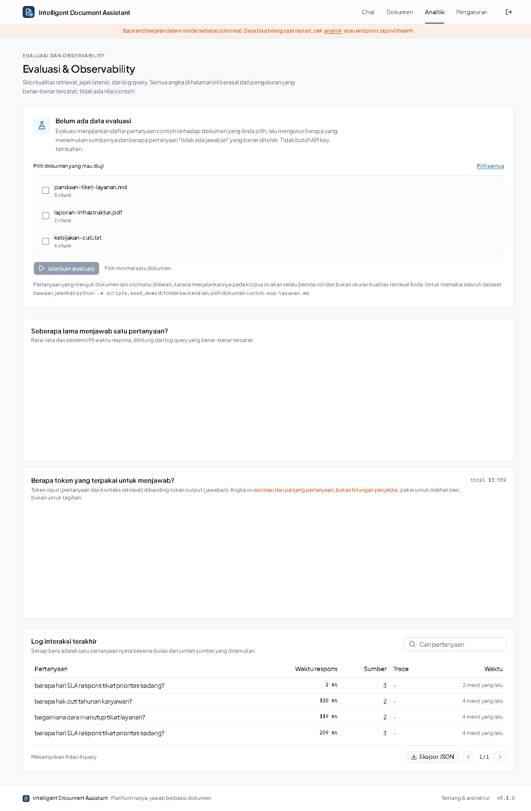
</p>

Latensi, jumlah sumber, dan log pertanyaan. Evaluasi retrieval bisa dijalankan
dari halaman ini tanpa API key, dan hasilnya disimpan supaya perubahan
retrieval bisa dibandingkan, bukan hanya dirasakan.

### Pengaturan

<p align="center">
  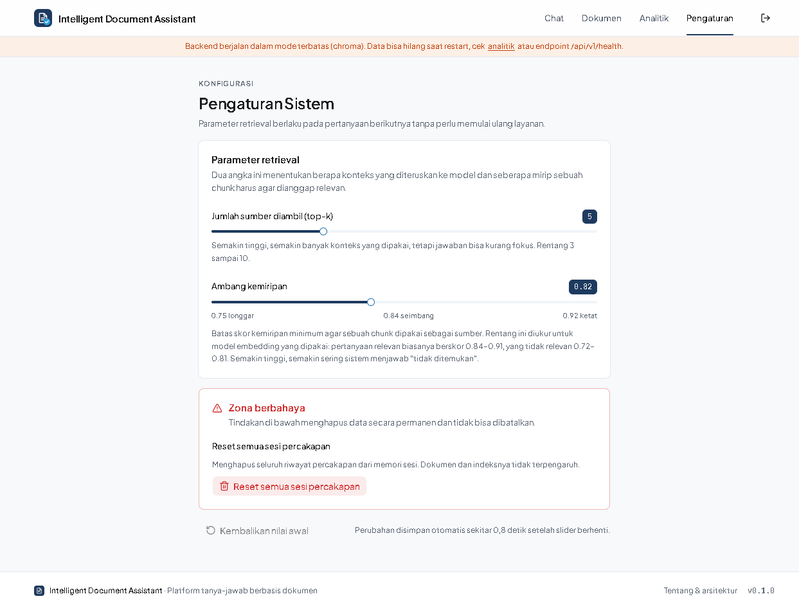
</p>

Dua parameter retrieval yang bisa diubah: jumlah sumber yang diambil dan ambang
kemiripan minimum. Nilainya disimpan otomatis ke backend, jadi berlaku untuk
semua sesi. Zona berbahaya untuk menghapus seluruh data dipisahkan tegas,
karena tindakan di sana tidak bisa dibatalkan.

### Tentang dan arsitektur

<p align="center">
  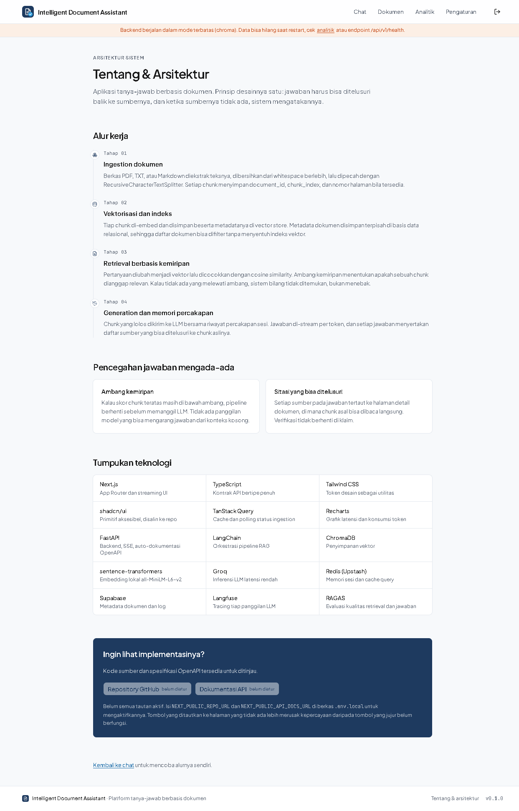
</p>

Penjelasan alur kerja dari unggah sampai jawaban, beserta tumpukan teknologi
dan alasan setiap pilihan. Halaman ini berguna saat menyerahkan proyek kepada
orang lain: yang perlu dipahami ada di sini, bukan tersebar di kode.

## Verifikasi dan pengujian

### Backend

```powershell
cd backend
python -m pytest                 # 623 test, coverage gate 70%
python -m ruff check app tests scripts
```

### Frontend

```powershell
cd frontend
npx tsc --noEmit
npm run lint
npm run build
```

### Uji ujung ke ujung lewat proxy

Butuh kedua server hidup. Skrip ini menguji alur lengkap: login, unggah,
tanya jawab, sitasi, dan mode jawab tanpa dokumen.

```powershell
cd backend
$env:E2E_PASSCODE = "passcode-anda"
python -m scripts.e2e_check
```

### Uji browser otomatis

59 skenario Playwright yang mencakup login, sesi yang bertahan melewati
perpindahan halaman, unggah tiga format berkas, tanya jawab dengan sitasi,
penolakan halusinasi, pratinjau PDF, scope beberapa dokumen, dan notifikasi.

```powershell
cd frontend
npx playwright test
```

E2E memakai **model embedding asli**, bukan stub, dan backend-nya harus
berjalan dengan `USE_LOCAL_EMBEDDING=1`. Alasannya terukur: ambang kemiripan
aplikasi (default 0,78, minimum 0,70) dikalibrasi untuk model
`intfloat/multilingual-e5-base`, yang memberi skor di atas ambang minimum untuk
pertanyaan yang relevan. Embedding stub hashing hanya memberi sekitar 0,49,
sehingga setiap pertanyaan dijawab "tidak ditemukan" walaupun dokumennya berisi
jawabannya. Dengan model asli, sitasi muncul sebagaimana di produksi.

Suite ini membersihkan dokumen dan sesi sebelum berjalan, lalu memulihkan
pengaturan retrieval sebelum setiap test, supaya hasilnya tidak terpengaruh
data dari run sebelumnya.

Saat dijalankan di komputer sendiri, Playwright sengaja tidak menyalakan
server. Jalankan backend dan frontend lebih dulu di dua terminal terpisah,
supaya log server tetap terbaca dan bisa dibedakan dari log test.

Di CI, rangkaian yang sama dijalankan otomatis pada setiap push lewat job
`End-to-end (Playwright)`. Job itu menyalakan backend dan frontend sendiri
dengan provider LLM `mock` dan embedding stub, jadi tidak ada API key, tidak
ada biaya, dan tidak ada model berukuran besar yang diunduh. Kalau job itu
gagal, laporan Playwright beserta tangkapan layar dan rekaman langkahnya
diunggah sebagai artefak `playwright-report` dan bisa diunduh dari tab
Actions.

Dua hal yang perlu diketahui tentang job ini:

- **Batas waktunya 60 menit**, jauh lebih longgar dari dua job lain. Test-nya
  mengunggah berkas sungguhan dan menunggu proses indeks selesai untuk setiap
  berkas, jadi totalnya memang lama.
- **Test sengaja berjalan satu per satu.** Banyak skenario mengunggah berkas
  dengan nama yang sama, dan pemeriksaan status mencocokkan baris tabel lewat
  nama berkas. Kalau dua skenario berjalan bersamaan, nama itu muncul di dua
  baris dan pemeriksaannya gagal secara acak. Test yang gagal acak lebih buruk
  daripada test yang lambat, karena hasilnya tidak bisa dipercaya.

## Evaluasi dengan RAGAS

Dataset berisi 11 pertanyaan: 8 harus terjawab benar, 3 **harus** dijawab
"tidak ditemukan". Kelompok kedua itu yang paling penting, karena di situlah
diukur apakah sistem mengarang saat tidak tahu. Kalau ada pertanyaan yang
seharusnya ditolak tapi justru dijawab, skrip keluar dengan kode error.

```powershell
cd backend
python -m scripts.seed_demo
python -m scripts.evaluate_ragas --dataset evaluation/dataset.json
```

### Mode offline tanpa API key

Skor RAGAS yang sesungguhnya butuh model penilai tambahan dan API key
(misalnya `OPENAI_API_KEY`). Untuk memeriksa bahwa pipa evaluasinya sendiri
sehat, ada mode offline yang memakai penilai tiruan deterministik:

```powershell
pip install -e ".[evaluation]"
python -m scripts.evaluate_ragas --offline
```

Mode ini tidak memanggil jaringan dan tidak memerlukan kredensial. Skornya
**bukan** ukuran kualitas jawaban, karena yang dihitung hanya kesesuaian
bentuk teks, dan karena itu skornya tidak disimpan ke tabel `eval_runs`.
Manfaatnya: kalau ada yang rusak di pemetaan kolom, nama metrik, atau cara
skor dibaca kembali, kerusakannya kelihatan di sini, bukan baru ketahuan saat
seseorang membayar token.

Mode ini sudah membuktikan dirinya. Sebelum dipakai, lima bug di jalur RAGAS
tidak pernah terlihat karena jalurnya tidak pernah dijalankan:

| Gejala | Sebab |
| --- | --- |
| `AttributeError: ... 'set_run_config'` | Penilai kurang method yang dituntut RAGAS |
| `AttributeError: ... 'generate'` | RAGAS memanggil dua nama method berbeda |
| `TypeError: object LLMResult can't be used in 'await'` | `generate` harus async |
| `RagasOutputParserException` | JSON harus mengikuti skema `PydanticPrompt` |
| Skor selalu kosong | `EvaluationResult` bukan dict, `.get()` selalu `None` |

Baris terakhir yang paling berbahaya: evaluasi selesai tanpa error, tetapi
halaman analitik tetap berkata "belum ada data evaluasi" selamanya.

### Catatan versi

Pasang `ragas==0.2.15`. Versi 0.4.x yang terbaru gagal diimpor dengan
`ModuleNotFoundError: langchain_community.chat_models.vertexai`, karena modul
itu sudah dihapus dari `langchain-community` sementara RAGAS masih
mengimpornya. Kombinasi yang terbukti jalan:

```powershell
pip install "ragas==0.2.15" "langchain<0.4" "langchain-community<0.4" "datasets>=3,<4"
```

## Deployment ke server

Panduan lengkap ada di **[backend/README.md](backend/README.md)**: satu
server dengan Caddy untuk TLS otomatis dan volume persisten. Tidak perlu
Supabase, Redis, atau object storage. Kodenya tidak terikat penyedia
tertentu, jadi VPS apa pun dengan Docker bisa dipakai.

### Kebutuhan minimum

| Komponen | RAM |
|---|---|
| Ubuntu dan Docker | ~300 MB |
| FastAPI dan ChromaDB | ~250 MB |
| torch saat dimuat | ~600 MB |
| Model embedding | ~470 MB |
| **Total** | **~1,6 GB** |

Jadi **2 GB RAM sudah cukup**. Dengan 1 GB, aplikasi tetap jalan tapi wajib
swap. Disk: sekitar 9 GB untuk sistem dan build cache, jadi 20 GB cukup dan
40 GB lebih lega.

### Cara cepat: satu skrip

Ada skrip yang mengerjakan seluruh langkah di bawah secara berurutan. Cocok
dipakai dari terminal web penyedia (OrcaTerm di Tencent), tanpa perlu SSH
dari komputer sendiri.

```bash
sudo apt-get update && sudo apt-get install -y git
git clone https://github.com/aldyardnsyh/IntelligenceDocumentSystem.git /opt/ida
cd /opt/ida/backend
bash scripts/setup-vps.sh
```

Skripnya menanyakan domain, email, passcode, dan Groq API key, lalu
mengerjakan sisanya: swap, Docker, konfigurasi, build, dan verifikasi.
Aman dijalankan ulang, dan konfigurasi yang sudah ada tidak ditimpa tanpa
bertanya.

Domain boleh nama apa saja, asalkan sudah mengarah ke IP server. Kalau belum
punya, <https://www.duckdns.org> memberi subdomain gratis, misalnya
`intelligencedocumentassistant.duckdns.org`. Cukup isi kolom `current ip`
dengan IP server lalu klik **update ip**.

Satu hal yang **harus** Anda lakukan sendiri di panel penyedia: **buka port
80 dan 443 di firewall**. Skrip tidak bisa menutupnya karena firewall-nya
ada di luar server, dan ini penyebab kegagalan yang paling sering.

### Ringkasan langkah manual

| Langkah | Yang dilakukan |
|---|---|
| 1 | Siapkan server, Ubuntu 24.04 |
| 2 | Buka firewall: hanya port 80 dan 443 |
| 3 | Siapkan domain. Bisa domain sendiri, atau DuckDNS gratis. Nama bebas |
| 4 | Swap (wajib kalau RAM 1 GB), pasang Docker, buat passcode, isi `.env` |
| 5 | Ganti domain di `backend/Caddyfile` |
| 6 | `docker compose up -d --build`, tunggu 5 sampai 15 menit |
| 7 | Verifikasi: health check, TLS, lalu unggah dokumen contoh dan tanya |

Tiga hal yang paling sering terlewat:

1. **Port 80 dan 443 di firewall penyedia.** Gejalanya menyesatkan: semua
   container sehat, API menjawab dari dalam server, tapi situs tidak bisa
   dibuka dan log Caddy penuh percobaan ACME yang gagal.
2. **Swap kalau RAM 1 GB.** Aplikasi ini butuh sekitar 1,6 GB. Tanpa swap,
   kernel akan membunuh container saat ingestion. Dengan RAM 2 GB, swap
   tidak wajib tapi tetap disarankan sebagai jaring pengaman.
3. **Domain di `Caddyfile`.** Nilai bawaannya `example.com` milik IANA, dan
   sertifikat TLS tidak akan pernah terbit untuk domain itu.

**Backend FastAPI tetap tidak bisa dijalankan di Vercel.** Batas bundle Hobby
250 MB, sedangkan `torch` sendiri 1.260 MB, dan Vercel tidak punya disk
persisten untuk SQLite maupun ChromaDB. Produksi tetap berjalan di VPS.
Penjelasan lengkapnya ada di `backend/README.md`.

**Frontend dapat dibangun tanpa backend.** Dengan `NEXT_PUBLIC_USE_BACKEND=0`,
seluruh alur berjalan di peramban: PDF dibaca di klien, pencarian memakai
kecocokan kata, dan tidak ada data yang dikirim ke mana pun. Mode ini dipakai
untuk pratinjau statis. Backend FastAPI tetap hanya berjalan di VPS.

## Struktur proyek

```
frontend/             Next.js 16 + React 19 + Tailwind v4 (9 halaman)
frontend/e2e/         59 skenario Playwright
frontend/scripts/     Pembuat favicon dari logo aplikasi
backend/              FastAPI + ChromaDB + SQLite + Groq, endpoint OpenAI-compatible, Ollama, atau SGLang
backend/samples/      Tiga dokumen contoh untuk uji manual
backend/evaluation/   Golden dataset untuk mengukur kualitas retrieval
backend/scripts/      Seed, reindex, uji ujung ke ujung, evaluasi RAGAS
API-CONTRACT.md       Kontrak endpoint frontend dan backend
LICENSE.md            Ketentuan lisensi
```

## Kualitas dan pengujian

Angka di badge atas bukan klaim, tapi hasil perintah berikut:

| Pemeriksaan | Perintah | Hasil |
|---|---|---|
| Test backend | `python -m pytest` | 623 test, coverage 84,78% |
| Lint backend | `python -m ruff check app tests scripts` | Bersih |
| Tipe dan lint frontend | `npx next typegen; npx tsc --noEmit; npm run lint` | Bersih |
| Build frontend | `npm run build` | Sukses |
| Uji browser | `npx playwright test` | 59 skenario |
| Uji ujung ke ujung | `python -m scripts.e2e_check` | 21 pemeriksaan |

Empat baris pertama juga dijalankan otomatis oleh GitHub Actions pada
setiap push, jadi angkanya tidak bisa basi tanpa badge CI ikut merah.

Cara menjalankan semuanya ada di bagian
[Verifikasi dan pengujian](#verifikasi-dan-pengujian).

## Keamanan

Yang sudah ditangani, dan alasannya:

| Area | Penanganan |
|---|---|
| Passcode | Dibandingkan sebagai SHA-256 dengan `hmac.compare_digest`, jadi selisih waktu tidak membocorkan berapa karakter yang cocok |
| Panjang passcode | Minimal 12 karakter, ditolak oleh `scripts.make_passcode`, bukan hanya disarankan |
| Sesi | Token acak 32 byte, disimpan di server, dicabut saat logout. Cookie `HttpOnly`, `SameSite=Lax`, `Secure` mengikuti skema permintaan |
| Rate limit login | 5 percobaan per 5 menit per IP, dengan header `Retry-After` |
| CORS | Origin harus disebut satu per satu. `*` ditolak saat start, karena aplikasi ini memakai cookie sesi |
| Kepemilikan sesi | Percakapan diikat ke token yang membuatnya. ID saja tidak cukup untuk membuka riwayat orang lain |
| Path traversal | Nama berkas disanitasi di server. Berkas asli disimpan dengan nama dari ID dokumen, bukan nama dari klien |
| SQL injection | Semua nilai lewat parameter binding. Nama kolom di `UPDATE` diambil dari daftar putih |
| XSS | Nama berkas dibersihkan dari markup di server. Frontend tidak memakai `dangerouslySetInnerHTML` |
| Prompt injection | Isi dokumen diberi penanda batas, prompt sistem menyatakan bahwa konteks adalah data bukan instruksi, dan setiap chunk dinilai classifier `llama-prompt-guard-2-86m` sebelum masuk prompt |
| PDF berbahaya | Batas 10 MB, batas 3000 halaman, dan batas waktu 120 detik per dokumen |
| Ukuran unggahan | Dibatasi tiga lapis: 16 MB di Caddy, `Content-Length` di route, lalu pembacaan bertahap |
| Kuota penyimpanan | Maksimal 200 dokumen dan 1 GB total. Ditolak dengan 507 dan pesan yang menyebut tindakannya |
| Kuota permintaan | Dikunci ke identitas stabil (hash passcode), bukan token sesi, supaya login ulang tidak mereset kuota |
| Indeks tidak cocok | Model embedding dicatat saat indexing. Kalau berbeda saat start, status `degraded` dan pesannya menyebut perintah perbaikan |
| Open redirect | `?next=` divalidasi dengan daftar karakter yang diizinkan, lalu dicek lagi hasil resolusi URL-nya |
| Clickjacking | `X-Frame-Options: SAMEORIGIN` dan `frame-ancestors 'self'`. SAMEORIGIN, bukan DENY, karena pratinjau PDF memakai iframe same-origin |
| Dokumentasi API | `/docs`, `/redoc`, dan `/openapi.json` mati secara default, dinyalakan bersama lewat `API_DOCS_ENABLED=1` |
| Endpoint publik | `/health` hanya mengirim `mode`, `vector_store`, `boot_id`. Nama repository, memory store, provider LLM, dan model embedding hanya ada di log server |
| Error | Pesan 500 selalu generik. Detail aslinya hanya masuk log server |

Konfigurasi yang berbahaya dicatat di log saat startup, bukan dibiarkan lewat
tanpa jejak: `DEBUG=true`, provider `mock`, passcode yang belum diisi,
dokumentasi API yang dinyalakan, dan origin `http://` untuk host non-lokal.

Audit dependensi:

```bash
# Frontend. Yang penting: nol kerentanan di dependency runtime.
npm audit --omit=dev

# Backend.
python -m pip install pip-audit
python -m pip_audit
```

`npm audit --omit=dev` bersih. Yang tersisa di `npm audit` penuh semuanya
berada di alat pengembangan (`shadcn` beserta rantai `fast-glob`), dan
paket-paket itu tidak ikut ke image produksi. `shadcn` juga sudah dipindahkan
ke `devDependencies` supaya batas itu terlihat jelas.

Sebelum menaruh aplikasi ini di internet, periksa daftar berikut:

| Setelan | Nilai yang benar |
|---|---|
| `DEBUG` | `false` |
| `CORS_ORIGINS` | Domain Anda, tanpa `*` |
| `ACCESS_PASSCODE_SHA256` | Diisi, dibuat dengan `python -m scripts.make_passcode` |
| `API_DOCS_ENABLED` | `0`, kecuali ini demo publik |
| `LLM_PROVIDER` | `groq`, `openai_compatible`, `ollama`, atau `sglang`; `mock` hanya untuk pengujian |
| `AUTH_OPEN_MODE` | `0` di produksi; `1` hanya untuk demo publik tanpa passcode |
| `TRUST_PROXY_HEADERS` | `1` kalau di balik Caddy, `0` kalau tidak |
| `NEXT_PUBLIC_DEV_PASSCODE_HINT` | Kosong |

## Keputusan teknis penting

| Keputusan | Alasan |
|---|---|
| SQLite, bukan database terkelola | Satu instance tidak butuh database terpisah |
| Penyimpanan sesi in-process, bukan Redis | Redis dibutuhkan saat banyak instance; di sini hanya satu |
| `multilingual-e5-base`, bukan model Inggris | Model Inggris jauh lebih buruk untuk Bahasa Indonesia |
| Ambang 0.78 pada bukti mentah | Diukur untuk e5-base: kandidat relevan dan tidak relevan tumpang tindih, ambang tunggal tidak bisa memisahkan keduanya |
| Jawaban tanpa konteks diberi label | Pengguna tetap mendapat jawaban, tapi tidak tertukar dengan yang bersumber dokumen |
| Scope dokumen disimpan di sesi | Sesi yang dibuka ulang mencari di tempat yang sama tanpa perlu diingat frontend |
| Proxy same-origin, bukan CORS | Cookie login hilang kalau browser dan backend berada di origin berbeda |
| Reranking cross-encoder multilingual | Ambang tunggal tidak bisa memisahkan kandidat; menilai ulang pertanyaan+chunk bersamaan menaikkan ketepatan urutan. Bisa dimatikan (`RERANK_ENABLED=0`) di mesin ber-sumber daya terbatas |
| Chunking per Pasal untuk dokumen hukum | Chunk berisi satu unit makna utuh dengan konteks BAB/Pasal, bukan potongan yang mulai dan berakhir di tengah kalimat |
| Heading digabung dengan paragraf berikutnya | Chunk yang isinya hanya judul tidak bisa menjawab apa pun, dan paragraf di bawahnya kehilangan konteks |
| Kunci kuota dari hash passcode, bukan token | Token berganti setiap login, jadi bucket ikut baru dan kuota bisa direset dengan login ulang |

Alasan lengkap setiap keputusan ditulis di komentar kode, tepat di tempat
keputusan itu dipakai.

## Line ending

`.gitattributes` menetapkan LF untuk berkas teks, dan CRLF khusus skrip
Windows (`.ps1`, `.bat`, `.cmd`). Sebelumnya repo ini bercampur antara CRLF
dan LF, sehingga perubahan satu baris bisa muncul sebagai diff seluruh berkas.

Kalau Anda menarik perubahan ini di checkout yang sudah ada, jalankan sekali:

```powershell
git add --renormalize .
git commit -m "chore: normalisasi line ending"
```

## Ikon aplikasi

Favicon dibuat dari logo yang sama dengan yang tampil di antarmuka. Berkasnya
`frontend/src/app/favicon.ico`, dibaca otomatis oleh Next.js. Untuk membuat
ulang setelah logo berubah:

```powershell
cd frontend
npm run favicon
```

## Lisensi

Hak cipta (c) 2026 PogungSoftwareHouseTeam (PSHT). Seluruh hak dilindungi.

Kode dalam repositori ini dikembangkan dan dimiliki oleh
PogungSoftwareHouseTeam (PSHT). Detail ketentuan penggunaan ada di
[LICENSE.md](LICENSE.md).

Dependensi pihak ketiga tunduk pada lisensi masing-masing, bukan pada lisensi
ini.

