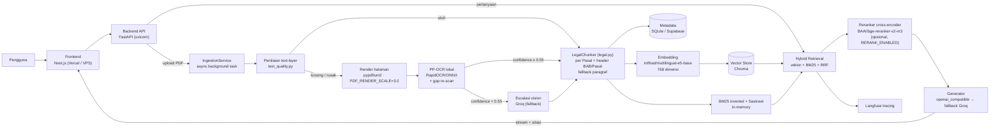
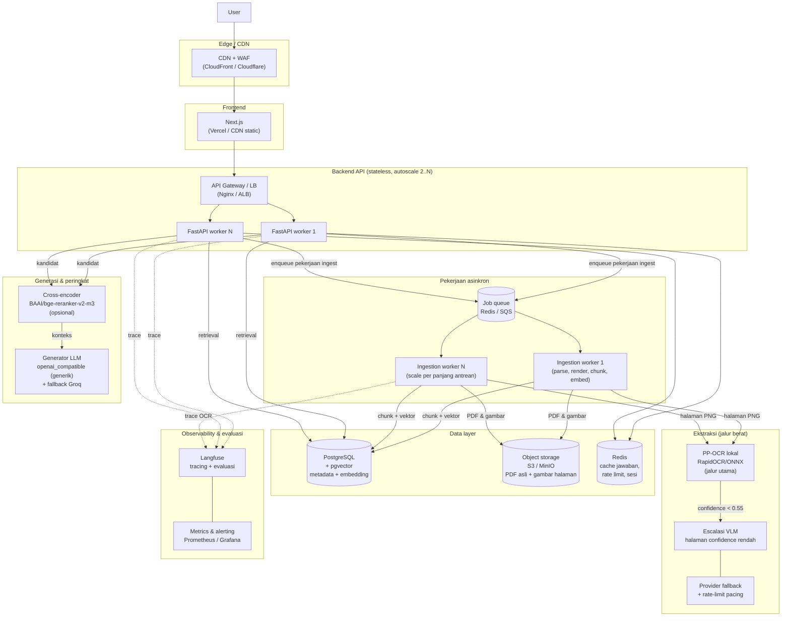

# Arsitektur Produksi: Skalabilitas & Deployment

> Deliverable B — bagaimana sistem ini di-scale dan di-deploy di lingkungan
> produksi nyata. Diagram ini dimulai dari arsitektur yang benar-benar berjalan
> di repo ini, lalu menunjukkan apa yang berubah saat beban tumbuh.

## 1. Arsitektur saat ini (repo ini)

Satu proses mengerjakan semuanya. Untuk portofolio dan demo dengan jumlah
dokumen puluhan, ini sengaja: tidak ada infrastruktur yang perlu dijaga, dan
seluruh pipeline tetap bisa diuji offline (stub provider + in-memory store).

PDF dinilai dulu text-layer-nya (`text_quality.py`). Yang utuh dipakai
langsung; yang kosong atau rusak dirender per halaman (`pypdfium2`,
`PDF_RENDER_SCALE=3.0`) lalu diekstraksi **PP-OCR lokal** (RapidOCR/ONNX).
PP-OCR memulihkan urutan baca dua kolom dari bounding box dan menjalankan gap
re-scan untuk baris yang tertutup cap. Hanya halaman dengan confidence di bawah
0.55 yang dieskalasi ke model vision Groq — bukan semua halaman. Chunking
mengikuti struktur hukum per Pasal dengan header konteks BAB/Pasal; dokumen
non-legal jatuh ke chunking paragraf.

Di jalur tanya, cache dan smalltalk diperiksa lebih dulu; smalltalk tidak
menyentuh retrieval. Kandidat hybrid vektor + BM25 (stemming Sastrawi) direrank
bila `RERANK_ENABLED=1`, dan konteks sekitar chunk ±1 ikut ke prompt sebagai
tetangga yang tidak boleh disitasi. Jawaban dibagi tiga tier: bukti kuat pada
ambang default 0.78, bukti lemah turun ke `WEAK_EVIDENCE_FLOOR=0.60` dengan label
"bukti terbatas", dan kosong menjadi "tidak ditemukan" + saran kata kunci.
Setiap potongan yang akan masuk prompt disaring classifier
`meta-llama/llama-prompt-guard-2-86m` yang dipin ke Groq dan bersifat
fail-open.

> **Catatan benchmark.** Dataset 22 soal Perpres 76 Tahun 2013 di
> `backend/evaluation/dataset-perpres.json` adalah contoh untuk tuning dan
> evaluasi — dipilih karena peraturannya kompleks dan ground truth-nya jelas —
> bukan dependensi arsitektur. Sistem berlaku untuk dokumen apa pun; dataset
> untuk dokumen lain dapat dibuat dengan format yang sama dan dijalankan lewat
> harness yang sama, dengan `--pdf` menunjuk berkas pengguna sendiri.

## 2. Arsitektur produksi untuk beban nyata

Batas arsitektur di atas muncul di empat tempat saat beban tumbuh:
OCR menahan event loop yang sama dengan API, embedding lokal memakan CPU
worker API, Chroma/SQLite tidak bisa dibagi antar instance, dan antrean
hilang saat restart. Diagram berikut memisahkan semuanya:

## 3. Keputusan skalabilitas per komponen

| Komponen | Sekarang | Produksi | Mengapa |
|---|---|---|---|
| Ingestion | Task asyncio di proses API: parse → nilai text-layer → OCR bila perlu → chunk → embed | **Worker terpisah** yang mengambil job dari queue (Redis/RQ atau SQS) | OCR + embedding panjang; harus tidak menahan request API dan tidak hilang saat deploy |
| OCR | **PP-OCR lokal (RapidOCR/ONNX)** untuk halaman yang perlu diekstraksi; halaman confidence < 0.55 dieskalasi ke model vision Groq, sekuensial + pacing | Perbanyak worker OCR lokal (CPU); eskalasi VLM hanya untuk halaman sulit, rate-limit per provider, job di-retry dari checkpoint halaman | Sebagian besar halaman selesai tanpa biaya API; halaman yang sudah sukses tidak boleh diulang saat provider kena limit |
| Embedding | `intfloat/multilingual-e5-base` (768 dimensi) di worker | Tetap di worker ingestion (bukan API), atau endpoint embedding terpisah saat throughput naik | CPU-bound; scaling worker ingestion = scaling embedding |
| Vector store | Chroma lokal | **pgvector** (dengan metadata di PostgreSQL yang sama) atau Qdrant cluster | Perlu dibaca-tulis antar banyak instance + filter metadata (`document_id`, `section`) |
| Metadata | SQLite / Supabase | PostgreSQL | Transaksional, cocok dengan pgvector |
| Retrieval | Hybrid vektor + BM25 (Sastrawi) dengan RRF in-memory; reranker `BAAI/bge-reranker-v2-m3` opsional | BM25 via **OpenSearch/Elasticsearch** saat korpus > ~100 ribu chunk; RRF tetap di API; reranker dipisah saat volume naik | Index BM25 in-memory tidak bisa dibagi antar instance; cross-encoder menahan CPU API |
| Cache & sesi | Redis (opsional) | Redis cluster, wajib | Cache jawaban + rate limit harus konsisten antar instance |
| File asli | Disk lokal | S3/MinIO + presigned URL untuk pratinjau PDF | Disk instance tidak tumbuh; pratinjau bisa langsung dari storage |
| Observability | Langfuse (opsional) | Langfuse + Prometheus + alert: tingkat kegagalan OCR, halaman kosong pasca-OCR, rasio halaman yang dieskalasi ke VLM, p95 latency retrieval | Kegagalan OCR yang diam-diam adalah mode kegagalan utama pipeline ini |

## 4. Strategi scaling

- **Horizontal dulu, bukan vertikal.** API dan worker ingestion stateless
  (state di Postgres/Redis/S3), jadi replika tinggal ditambah. HPA pada CPU
  untuk API; KEDA pada panjang antrean untuk worker ingestion.
- **Pisahkan lonjakan OCR dari lonjakan query.** Upload massal dokumen pindai
  membuat antrean ingestion panjang tanpa memengaruhi latensi chat — itu
  tujuan utama pemisahan worker. OCR lokal yang CPU-bound dijalankan di worker,
  bukan di proses API.
- **Batch OCR per dokumen dengan checkpoint.** Satu job = satu dokumen;
  halaman yang selesai tersimpan, retry lanjut dari halaman berikutnya —
  termasuk halaman yang menunggu eskalasi VLM.
- **Degradasi terkontrol saat provider vision turun**: fallback ke text-layer
  (sudah ada di kode) + job masuk antrean ulang dengan backoff, bukan gagal
  diam-diam.
- **Mode demo publik bukan mode produksi.** `AUTH_OPEN_MODE=1` menerbitkan sesi
  otomatis dan melewati passcode; di produksi nilainya harus `0` karena mode
  itu tidak punya akun per pengunjung maupun isolasi data antar pengunjung.
- **Deployment**: Docker image tunggal backend (repo ini sudah punya
  `Dockerfile`), Frontend Vercel, PostgreSQL + Redis managed. CI menjalankan
  pytest + ruff sebelum build.

## 5. Ukuran yang menentukan kapan pindah ke diagram produksi

| Sinyal | Ambang kira-kira | Aksi |
|---|---|---|
| Antrean ingestion sering menumpuk saat traffic chat tinggi | p95 upload-to-ready > 2 menit | Pindah ingestion ke worker + queue |
| Chroma sering dikunci antar instance | ≥ 2 instance API | pgvector/Qdrant |
| Korpus chunk | > 100 ribu | BM25 → OpenSearch |
| Eskalasi VLM sering kena limit harian | ≥ 3 dokumen pindai/hari yang butuh eskalasi | Perbanyak worker OCR lokal; pool VLM berbayar / self-host untuk eskalasi |
| Cache jawaban membusak antar instance | ≥ 2 instance API | Redis wajib |

Dengan urutan itu, langkah scale pertama selalu yang paling murah dan
paling menunda kebutuhan infrastruktur berat.
